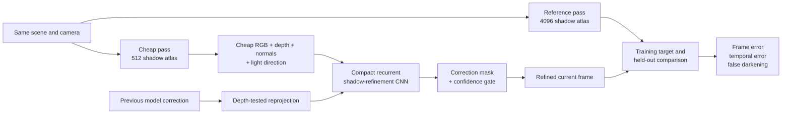
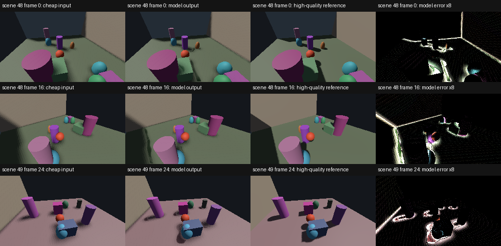

# dlss66 — lightweight neural rendering research

Completed research prototype for renderer-conditioned neural shadow refinement, inspired by public DLSS 5 ideas. This project does not reproduce NVIDIA DLSS 5. It contains deterministic RGB and geometry-conditioned models, temporal experiments, a one-call diffusion-distilled student, and a procedural Godot capture testbed.

## Research outcome

The completed prototype shows that renderer RGB plus depth, normals, light direction, and reprojected history can support learned shadow refinement on small procedural scenes. Models repeatedly lower frame MAE against the cheap shadow render. They do not yet meet the joint targets for temporal stability and preservation of unchanged pixels: temporal error remains higher than the cheap render, and false darkening varies by held-out scene. A confidence gate, expanded scene training, and boundary weighted preservation loss did not resolve both failures. This is evidence for a narrow shadow-refinement proof of concept, not a DLSS equivalent or a real-time renderer. Full measurements and the stopping rationale are in [TEMPORAL_NEXT_STEP_RESEARCH.md](docs/TEMPORAL_NEXT_STEP_RESEARCH.md) and [EXPERIMENT_LOG.md](docs/EXPERIMENT_LOG.md).

| Latest fresh-scene candidate | Frame MAE (model vs cheap) | Temporal error (model vs cheap) | False darkening | Result |
|---|---:|---:|---:|---|
| Static scenes 50–51 | 0.01104 vs 0.01320 | 0.00787 vs 0.00691 | 0.110% | Fails 0.1% preservation cap |
| Moving scenes 52–53 | 0.01298 vs 0.01495 | 0.00757 vs 0.00720 | 0.046% | Passes preservation cap; temporal error still higher |

These are small procedural-scene holdouts. They do not establish general performance across real games or engines.

Project docs: [model architecture diagram](docs/MODEL_ARCHITECTURE.md), [model design](docs/MODEL_DESIGN.md), [training method](docs/TRAINING_METHODOLOGY.md), [experiment log](docs/EXPERIMENT_LOG.md), and [published DLSS 5 architecture](docs/DLSS5_ARCHITECTURE.md). Earlier [graphics research](docs/RESEARCH.md), [AO-centered architecture](docs/ARCHITECTURE.md), and [original plan](docs/IMPLEMENTATION_PLAN.md) remain for historical context; AO is an optional baseline.

## How the shadow-refinement experiment works

The same procedural scene and camera produce a cheap input and a higher-quality training reference. The model receives RGB plus renderer geometry and light direction. For later frames, it also receives the previous predicted correction after reprojection into the current view.



This diagram describes the offline research pipeline. The recurrent model has not been integrated into a measured end-to-end Godot renderer path.

The detailed [model architecture diagram](docs/MODEL_ARCHITECTURE.md) shows all 15 input channels, the encoder-decoder feature sizes, output heads, and history fusion rule.

### Example output

Each row is a held-out moving scene frame. The columns show the cheap input, the model output, the higher-quality reference, and the model error amplified 8×. The model adds some missing shadow detail, but visible differences remain; this is a qualitative example, not proof that all scenes improve.



The image is generated from scenes 48 and 49 with:

```sh
python3 -m evaluation.visualize_recurrent --data dataset/expanded_motion_test --checkpoint artifacts/shadow_refine_confidence_expanded_mps.pt --output artifacts/expanded_model_output.png --frame 48 0 --frame 48 16 --frame 49 24
```

## Quick start: minimal pipeline smoke test

Requires Python 3, PyTorch, and NumPy. The synthetic pairs below are a training-pipeline smoke test only.

```sh
python3 -m unittest discover -s tests -v
python3 -m training.train --steps 8 --height 128 --width 128 --device auto
python3 -m evaluation.benchmark --device auto --height 144 --width 256
```

`auto` selects CUDA, then MPS, then CPU. Training writes an ignored checkpoint in `artifacts/`. See [MODEL_DESIGN.md](docs/MODEL_DESIGN.md) for exact tensor operations and [EXPERIMENT_LOG.md](docs/EXPERIMENT_LOG.md) for measured M2 results. Model-only timing excludes rendering and frame transfer.

## Godot capture

Download the [official Godot 4.7.2 macOS editor](https://github.com/godotengine/godot-builds/releases/tag/4.7.2-stable), unpack `Godot.app` into `tools/`, then run:

```sh
sh capture.sh
```

Expected output: `captures/scene.png`, `depth.png`, `normal.png`, and numerical `.npy` arrays. The command imports the compute shader, exports the renderer buffers, then checks their contents. See [TEST_RESULTS.md](TEST_RESULTS.md) for results and limits.

The official Godot binary is kept in `tools/` and ignored by Git. The test scene uses procedural boxes and no copyrighted game assets.

## Paired renderer data

With the same pinned Godot app and Python packages NumPy and Pillow, run:

```sh
sh collect_dataset.sh
```

This generates 480 local RGB pairs at 256×144 in ignored `dataset/raw/`, plus depth/normal geometry for each cheap frame, `manifest.jsonl`, and `summary.json`. Each pair uses the same procedural scene and camera; the cheap pass has directional shadows off and the reference pass has them on. The split is 336 train, 24 validation, 24 development, and 96 fresh test frames by scene. See [DATASET.md](docs/DATASET.md) for the exact format, validation results, and limitations. This is a small supervised shadow reconstruction dataset, not a DLSS 5 dataset.

The primary experiment refined low-resolution shadows in the cheap input using a higher-resolution shadow atlas as the reference. The commands below reproduce the spatial-mask baseline:

```sh
DLSS66_OUTPUT=dataset/shadow_resolution DLSS66_TASK=shadow_resolution DLSS66_LAYOUTS=32 sh collect_dataset.sh
python3 -m training.train_pairs --kind shadow_refine_mask --changed-weight 20 --epochs 20 --data dataset/shadow_resolution --device auto --output artifacts/shadow_refine_mask_32.pt
python3 -m evaluation.final_holdout --data dataset/shadow_resolution --kind shadow_refine_mask --checkpoint artifacts/shadow_refine_mask_32.pt --output artifacts/shadow_refine_holdout_32.json --device auto
python3 -m evaluation.calibrate_mask --kind shadow_refine_mask --data dataset/shadow_resolution --checkpoint artifacts/shadow_refine_mask_32.pt --device auto
DLSS66_SCENE_START=32 DLSS66_LAYOUTS=4 DLSS66_OUTPUT=dataset/shadow_resolution_fresh DLSS66_TASK=shadow_resolution sh collect_dataset.sh
python3 -m evaluation.final_holdout --data dataset/shadow_resolution_fresh --kind shadow_refine_mask --mask-bias 1.5 --checkpoint artifacts/shadow_refine_mask_32.pt --output artifacts/shadow_refine_holdout_fresh.json --device auto
python3 -m evaluation.temporal_blend --device auto --mask-bias 1.5
python3 -m evaluation.benchmark_refinement --device auto
python3 -m evaluation.visualize_refinement --data dataset/shadow_resolution_fresh --scenes 32 33 34 35 --mask-bias 1.5 --device auto
```

Across procedural scene holdouts, trained models usually lower frame MAE against the cheap render. Recurrent variants still have higher temporal error than the cheap renderer, and preservation varies across scenes. Confidence gating, additional training scenes, and a boundary weighted preservation loss did not meet all quality, stability, and false-darkening targets together. The work establishes a proof of concept for learned shadow refinement; it does not establish robust temporal quality or real-time end-to-end performance. See the [final findings and stopping rationale](docs/TEMPORAL_NEXT_STEP_RESEARCH.md).

## Earlier live M2 feasibility check (2026-11-16)

The earlier Godot/PyTorch bridge displayed model output in a separate overlay. Its aligned 48-frame run used **RGB-only conditioning**. Reproduction commands for that historical feasibility check follow; the recurrent model has not been integrated into this bridge:

```sh
python3 -m evaluation.serve_live --checkpoint artifacts/shadow_refine_rgb_balanced2_32.pt --kind shadow_refine_rgb --device mps --frames 48 --warmup 10 --mask-bias 4 --hard-mask
DLSS66_VARIANT=cheap DLSS66_TASK=shadow_resolution DLSS66_LIVE_RGB_ONLY=1 DLSS66_LIVE_FRAMES=48 DLSS66_OUTPUT=dataset/shadow_resolution tools/Godot.app/Contents/MacOS/Godot --path . -- --live
```

To run the full geometry-conditioned model instead, start the matching server and omit `DLSS66_LIVE_RGB_ONLY`:

```sh
python3 -m evaluation.serve_live --checkpoint artifacts/shadow_refine_mask_balanced2_32.pt --kind shadow_refine_mask --device mps --port 8766 --frames 48 --warmup 10 --mask-bias 4 --hard-mask
DLSS66_VARIANT=cheap DLSS66_TASK=shadow_resolution DLSS66_LIVE_FRAMES=48 DLSS66_OUTPUT=dataset/shadow_resolution tools/Godot.app/Contents/MacOS/Godot --path . -- --live
```

After startup, serial RGB-only processing took **27.70 ms median / 35.50 ms p95** at 256×144. The 11-channel geometry-conditioned model also completed a 48-frame run: **166.58 ms median / 167.22 ms p95**, about 6 FPS. It lowered mean RGB MAE from 0.005956 to 0.005544 on this repeated scene-28 integration sequence, with improvement in 32/48 frames. This is a small visual gain at an unacceptable cost for real-time use. The largest measured components were camera/render synchronization (66.60 ms), geometry export/readback wait (33.41 ms), RGB readback (18.15 ms), and presentation plus remaining work. These are host-observed stage times, not isolated GPU kernel durations. See [EXPERIMENT_LOG.md](docs/EXPERIMENT_LOG.md) for measurement details and limitations.

## Shadow-model experiments

With the local paired data, run the three experiments in order:

```sh
python3 -m training.train_pairs --kind cnn --epochs 20 --device auto --output artifacts/shadow_cnn.pt
python3 -m training.train_pairs --kind multiscale --epochs 20 --device auto --output artifacts/shadow_multiscale.pt
python3 -m training.train_one_step --teacher-steps 200 --student-steps 100 --device auto
python3 -m evaluation.compare_shadow --device auto
```

The third command trains a conditional diffusion noise predictor, samples it with eight deterministic DDIM steps, then distills those outputs into a one-call student. This is a small **diffusion-distillation experiment**, not NVIDIA's disclosed implementation. The original 96-pair results, where none beat the cheap input, are in [EXPERIMENT_LOG.md](docs/EXPERIMENT_LOG.md) and can be reproduced from commit `778cc70`. These commands use the expanded dataset when run on current `main`. Checkpoints and comparison images are local in ignored `artifacts/`.

The newer geometry-conditioned comparison uses the expanded dataset:

```sh
python3 -m training.train_pairs --kind multiscale --epochs 20 --device auto --output artifacts/shadow_rgb_16.pt
python3 -m training.train_pairs --kind geometry --epochs 20 --device auto --output artifacts/shadow_geometry_16.pt
python3 -m evaluation.compare_geometry --device auto
```

The geometry model takes RGB, depth, view normals, a valid-depth mask, and view-space light direction. It improved aggregate held-out image error, but did not improve every scene. Its checkpoint and comparison image remain local in `artifacts/`. This older, harder shadow-creation task remains a useful failure case.
